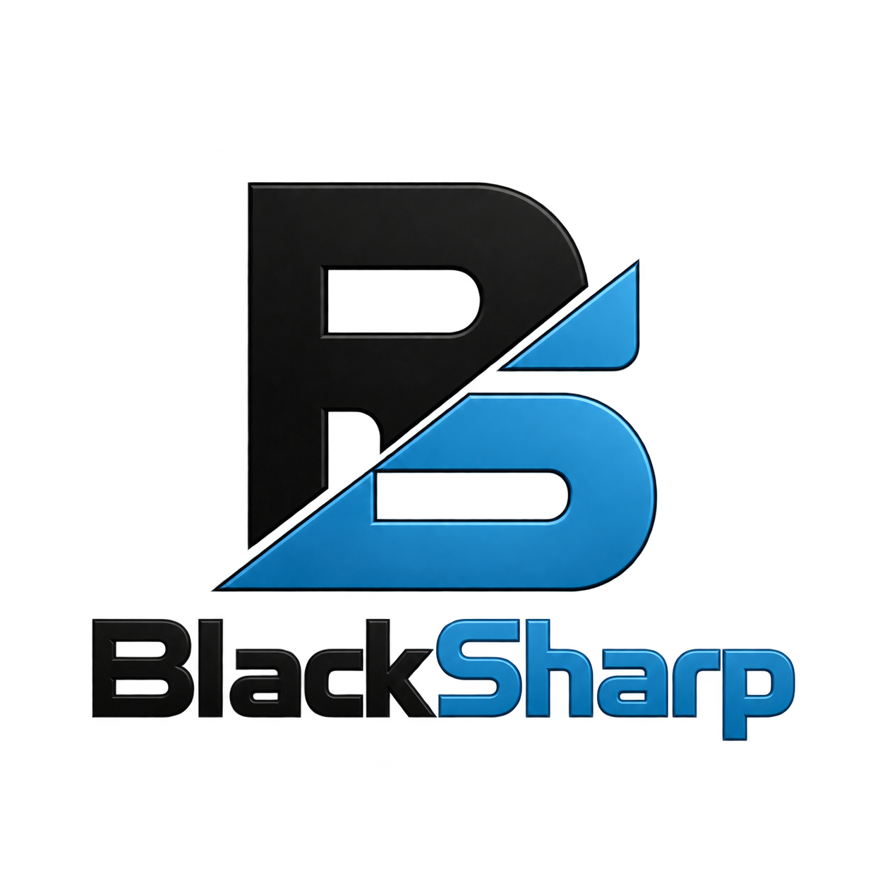

<h1 align="center">BlackSharp Markdown Viewer for Avalonia</h1>

<p align="center">
    
</p>

[](https://www.nuget.org/packages/BlackSharp.UI.Avalonia.Markdown/)
[](https://www.nuget.org/packages/BlackSharp.UI.Avalonia.Markdown/)

[](#requirements)
[](https://github.com/sponsors/Blacktempel)
[](https://paypal.me/Blacktempel)
[](LICENSE)

**Display Markdown release notes and documentation.**

BlackSharp.UI.Avalonia.Markdown renders documents with native Avalonia controls.

This is not an official Avalonia release.

## Key capabilities

- `MarkdownViewer` renders CommonMark, including headings, links, emphasis, lists,
  quotes, code blocks and images
- `GitHubMarkdownViewer` adds tables, task lists, strikethrough, autolinks, alerts,
  emoji shortcodes, footnotes and heading anchors
- Relative link and image resolution, opt-in remote images and a custom image loader

The [demo](Samples/BlackSharp.UI.Avalonia.Markdown.Demo/) uses a shared text box
to compare the same source in the GitHub Markdown and CommonMark previews.

## Supported .NET versions

| .NET version | Support |
| --- | --- |
| .NET 8  | ✅ |
| .NET 10 | ✅ |

## Requirements

Add the package to a local NuGet feed or reference the library project directly.
Once the feed is configured, add the package to your application:

```shell
dotnet add package BlackSharp.UI.Avalonia.Markdown
```

Add the following namespace to the XAML root. No additional theme include is required:

```xml
xmlns:md="clr-namespace:BlackSharp.UI.Avalonia.Markdown.Controls;assembly=BlackSharp.UI.Avalonia.Markdown"
```

## Examples

### Read-only release notes

Both controls show only the preview by default:

```xml
<md:GitHubMarkdownViewer Text="{Binding ReleaseNotes, Mode=OneWay}" />
```

### Source editor and live preview

Set `ShowEditor="True"` to display the source editor. The panes sit side by side
on wide layouts and stack on narrow layouts. `Text` binds two-way by default.
Set `IsReadOnly="True"` to prevent edits while keeping the editor visible and
its text selectable.

```xml
<md:GitHubMarkdownViewer Text="{Binding ReadmeText}"
                         ShowEditor="True"
                         EditorWatermark="Enter Markdown"
                         AllowRemoteImages="True"
                         BaseUri="https://github.com/Blacktempel/BlackSharp/blob/master/"
                         ImageBaseUri="https://raw.githubusercontent.com/Blacktempel/BlackSharp/master/"
                         LinkClicked="OnLinkClicked" />
```

## Links, images and GitHub support

The preview handles local fragment navigation. HTTP, HTTPS and mail links raise
`LinkClicked` for the host to handle. The event argument is
`MarkdownLinkClickedEventArgs`. An `ILogger` from BlackSharp.Core receives
render and image errors, when configured.

Remote images are off by default. Enable them only if the document may trigger
HTTPS requests, or supply an `ImageLoader` with your own allowlist and image policy.
The built-in loader loads up to 16 raster images per preview, with a 4 MiB and
2 megapixel limit per image. Alt text remains visible when an image is not loaded.
A custom provider can add formats such as SVG.

Scripts, frames, arbitrary CSS and local-file destinations are not supported.

## Projects and development

| Project | Purpose |
| --- | --- |
| [`BlackSharp.UI.Avalonia.Markdown`](BlackSharp.UI.Avalonia.Markdown/) | Reusable controls and NuGet package |
| [`BlackSharp.UI.Avalonia.Markdown.Demo`](Samples/BlackSharp.UI.Avalonia.Markdown.Demo/) | Interactive editor and preview comparison |

## License

This repository is licensed under the [Mozilla Public License 2.0](LICENSE).

### Origin

Markdown parsing is provided by [Markdig](https://github.com/xoofx/markdig) and HTML
parsing by [Html Agility Pack](https://github.com/zzzprojects/html-agility-pack).

GitHub syntax follows the [GFM specification](https://github.github.com/gfm/)
and the [GitHub formatting documentation](https://docs.github.com/en/get-started/writing-on-github/getting-started-with-advanced-formatting).

Alert icons use GitHub's [Primer Octicons](https://github.com/primer/octicons/tree/v19.19.0)
under the [MIT license](LICENSE-Octicons).
